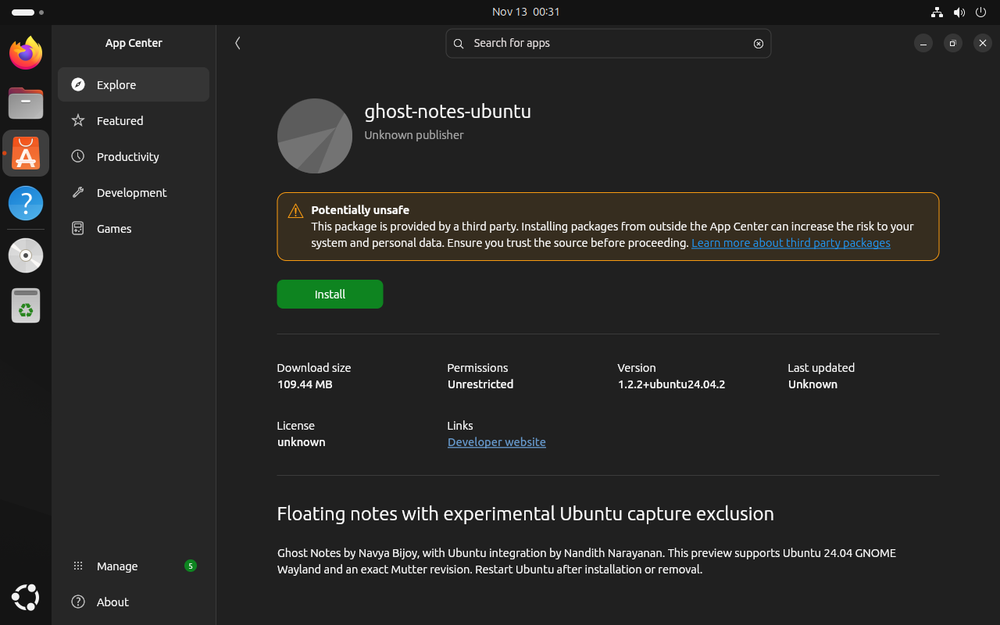

# Ubuntu .deb installation validation — 13 November 2026

Target: Ubuntu 24.04.5 LTS, GNOME 46, Wayland, Mutter
`46.2-1ubuntu0.24.04.18`, amd64, software-rendered VM.

Package: `ghost-notes-ubuntu_1.2.2+ubuntu24.04.2_amd64.deb`.

[Package checksum and checks](package.json).

## Verified

- A separate build VM compiled the native component and assembled the installer.
  The original target VM had no Ghost Notes installation, Node.js or npm:
  [pre-installation state](preinstall.json).
- A single `apt install ./…deb` installed the app and automatically resolved the
  missing runtime package `libdisplay-info1`. No compiler, Node.js, npm, Git or
  manual integration command was used to install the package on the target.
- After restarting into GNOME Wayland, the packaged launcher opened the app.
  Capture exclusion was verified active, normal storage used GNOME libsecret
  encryption, a test note was saved, the share/private toggle worked, and the
  packaged ghost-mode input helper ran: [runtime report](runtime.json).
- A real XTest mouse click switched ghost mode off in the installed package.
- Reinstall passed without replacing the stock backup with a patched library.
- Removal restored Ubuntu's original library, removed the capture service
  override/diversion and preserved the encrypted notes file byte for byte:
  [uninstall report](uninstall.json).
- The actual package pre-install script rejected an incompatible compositor
  revision. Sandbox ownership/mode and `ldconfig` library selection were checked.
- Ubuntu's default graphical `.deb` handler is App Center
  (`snap-store_snap-store.desktop`). Automated installation used apt; clicking
  Install in App Center remains part of the user's manual test.
- App regression suite: 132 passed, 7 skipped. Installer transaction suite:
  8 passed, including missing-library refusal and activation rollback.

## Capture evidence and remaining scope

The packaged native component has SHA-256
`09d3a8e6d5788bb858ca5c45258eefb528368fc0052fd1fd5567ab316dfacc24`,
identical to the earlier tested companion. See the [real PipeWire capture
comparisons and manual Meet result](../ubuntu-gnome-20261112/README.md).
A new live meeting test of the packaged build is still available for manual
verification. Zoom, physical GPUs, multiple monitors, fractional scaling and
other Ubuntu/Mutter revisions are not certified by this package test.

The first local package preview exposed an undeclared runtime library during
clean-VM testing. It was rolled back and removed from the download folders.
The corrected package derives native dependencies using `dpkg-shlibdeps` and
refuses activation if `ldd` finds missing libraries, before changing the stock
compositor.

## Handoff state

The package was uninstalled after testing, and the synthetic note profile/key
were removed. The corrected `.deb` and checksum remain in the VM's Downloads
folder for a manual installation test. Build dependencies remain confined to the
separate, powered-off build VM. The original clean snapshot remains available.
