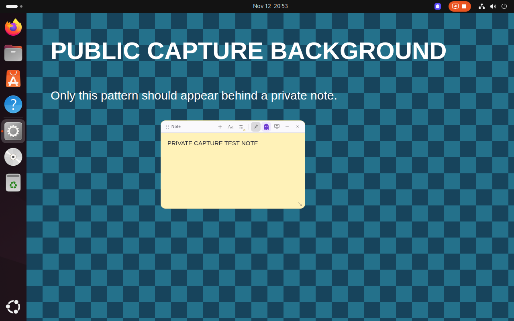
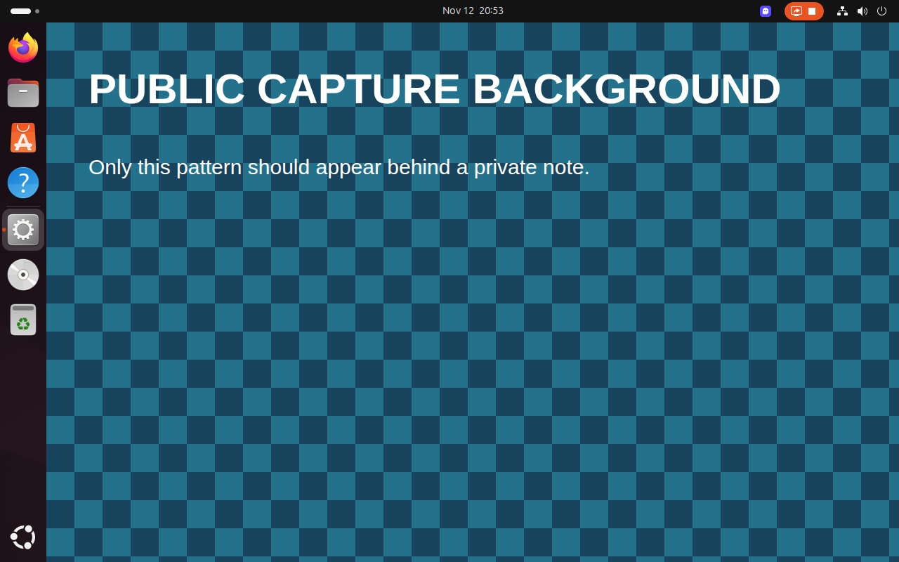

# Ubuntu GNOME capture validation — 12 November 2026

Experimental integration tested in the `ghost-notes-ubuntu` VM: Ubuntu 24.04.5 LTS, GNOME Shell 46.0, Mutter `46.2-1ubuntu0.24.04.18`, Wayland, software rendering, 1280 × 800 at scale 1.

The note stays visible on the local display while the real Mutter ScreenCast/PipeWire stream shows the live content behind it. Turning on the note’s sharing button makes it appear in the stream; turning it off hides it again.

| View                                   | Public test fixture                 |
| -------------------------------------- | ----------------------------------- |
| Local display, private note visible    |  |
| PipeWire capture, private note omitted |  |

## Pixel checks

A 360 × 220 note covers 79,200 pixels. Each capture was compared against the same live background with the note hidden. Both full-monitor and rectangular-area streams were tested.

| Integration                            | Private | Shared | Private again |
| -------------------------------------- | ------: | -----: | ------------: |
| Enabled, monitor and area              |       0 | 79,200 |             0 |
| Stock Ubuntu control, monitor and area |  79,200 | 79,200 |        79,200 |

Values are different pixels within the note region. Zero means the capture exactly matches the unobstructed background. Raw results are in [prototype.json](prototype.json) and [stock-control.json](stock-control.json).

## Other verification

- Disabled the companion, restored the original system library, restarted GNOME and ran the stock control above. The app correctly reported capture protection unavailable.
- Re-enabled the companion, restarted GNOME and repeated successful exclusion tests. The VM is left with the companion enabled.
- App tests on the host and inside Ubuntu: 131 passed, 7 skipped, 0 failed.
- Normal profile uses encrypted GNOME libsecret storage; runtime status is saved in [normal-profile.json](normal-profile.json). Normal startup was restored and debugging ports removed from the running app.
- The fixture and capture tests use synthetic public text, separate from the normal encrypted profile.

## Remaining validation

A live Google Meet/Zoom call inside Ubuntu still needs manual testing. Physical GPU/DMA-BUF capture, multiple monitors, fractional scaling and explicit note-window streams have not been independently tested. Screenshots and direct X11/KMS capture are outside this integration’s scope. This is a VM prototype for the exact Mutter version above, not a general Ubuntu installer.

Implementation, activation and rollback instructions: [GNOME companion](../../integrations/gnome-capture/README.md).

## Ghost-mode input follow-up

After the manual Google Meet test succeeded, an Ubuntu toolbar recovery issue was reported. GNOME/XWayland now uses an X Shape input region instead of relying on Electron cursor polling: the 30-pixel toolbar and 6-pixel resize edges remain interactive while the body passes clicks through. Opening a toolbar menu or leaving ghost mode restores the full input region. A companion process updates the region when the window size changes and restores full input when stopped.

Verified real XWayland input regions in the VM using a disposable window: toolbar and resize edge included, body excluded, and full input restored across repeated on/off changes. Updated app regression suite: 132 passed, 7 skipped, 0 failed. Button states now use steady colours; the pin indicates that ghost mode keeps the note on top and explains why pin changes are temporarily unavailable.

Follow-up deployment verification: the earlier VM app process had remained running after the first update. It was explicitly stopped, and the updated app was exercised using synthetic notes. A real XTest mouse click on the ghost toolbar button switched ghost mode off while a Mutter/PipeWire stream was confirmed continuously active. The normal profile was then restored in a verified fresh process. The user's live Google Meet invisibility test also passed; Zoom remains unverified on Ubuntu.
